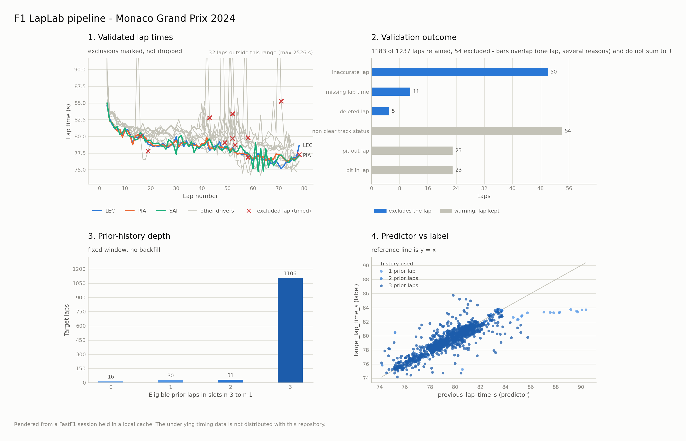

# F1 LapLab

**Formula 1 Lap Data Engineering & Strategy Analysis**

F1 LapLab is a focused Python project with three parts:

1. A data pipeline that transforms historical Formula 1 timing data into
   validated, structured, leakage-safe lap-level datasets suitable for future
   machine-learning work. It demonstrates data ingestion, canonical validation,
   domain modelling, temporal feature engineering, and automated quality checks.
2. A baseline upcoming-lap-time model, evaluated against naive predictors with
   splits that hold out whole race weekends.
3. A deterministic one-stop pit-strategy baseline that ranks every feasible
   one-stop plan under explicit, user-supplied assumptions.

**It is not a production prediction system or a calibrated race simulator.**
No results on real race data are published in this repository yet.

## Problem and capabilities

Historical timing data arrives in provider-specific formats and can contain
missing, invalid, duplicated, or otherwise exceptional lap records. F1 LapLab
isolates the FastF1 boundary, converts data into an explicit canonical contract,
records validation exclusions, and builds prior-only features for predicting an
observed upcoming lap time.

- Load a selected session through the FastF1 adapter and configured cache.
- Convert timing data into the strict canonical lap schema.
- Validate canonical validity and report excluded rows and warnings.
- Represent canonical rows as typed `LapRecord` values.
- Build aligned identifiers, features, labels, and exclusion traces for each
  session, without crossing session boundaries.
- Fit a baseline lap-time model and score it against naive predictors with
  leave-one-weekend-out evaluation.
- Run offline tests without accessing F1 data services.

## Architecture and data flow

The installable `f1strategy` package uses a `src/` layout and keeps provider
coupling behind the telemetry boundary:

```text
FastF1 session
  -> FastF1SessionLoader
  -> FastF1-to-canonical conversion
  -> LAPS_SCHEMA validation
  -> LoadedSession
      -> LapRecord values (optional representation)
      -> LapFeatureDataset
          -> baseline lap-time models + leave-one-weekend-out evaluation (modeling)
          -> matplotlib figures (visualization)
```

`domain` owns session identities, metadata, typed lap records, protocols,
enums, and the schema. `config` owns injected settings, project paths, and
logging. `telemetry` loads and converts FastF1 data and validates canonical
frames. `features` builds session-local, prior-only lap datasets. `modeling`
fits and evaluates baseline predictors on those datasets.
`visualization` turns those validated objects into static matplotlib figures;
it loads no data and writes no files, returning figures for the caller to save.

`strategy` is the deterministic one-stop strategy baseline described
[below](#deterministic-one-stop-strategy-baseline). It depends only on `domain`
and does not consume pipeline output yet.

See the [current architecture overview](docs/architecture/ARCHITECTURE.md).

## Feature dataset contract

The public feature API is:

```python
build_lap_features(LoadedSession) -> LapFeatureDataset
```

The target is `target_lap_time_s`: the target lap's observed time in seconds.
The prediction cutoff is immediately before that lap begins. The feature matrix
contains exactly:

| Feature | Meaning |
|---|---|
| `previous_lap_time_s` | Same driver's eligible lap at the exact `n-1` slot. |
| `prior_3lap_mean_time_s` | Mean of eligible observations in exact slots `n-3` through `n-1`. |
| `prior_3lap_valid_count` | Number of eligible observations used by that mean (0–3). |

History is session-local and keyed by driver and lap number. Missing or
ineligible slots remain missing; the mean uses available eligible observations
in the fixed window and does not backfill or extend it. Every canonically valid
timed lap is an eligible target, including pit-in/out and non-clear-track-status
laps. Duplicate eligible driver/lap identities are errors, not silently
discarded.

Identifiers and labels remain separate from predictors. Target time, target-lap
state, and future observations are not feature inputs. Tests include
perturbation and append checks to verify earlier features are unchanged by
future-lap changes.

### Scope of the leakage guarantee

The guarantee is precise about what it covers. No lap time, event marker, or
track status at or after the target lap enters a feature. It does not claim
that every input would have been knowable in a live session: prior-lap
*eligibility* is the canonical validity rule, which depends on `Deleted` and
`IsAccurate`. Both are determined after the fact — a lap time can be deleted by
the stewards some laps later, and `IsAccurate` is derived by the data provider.
A prior lap can therefore be excluded from history on information that post-dates
the stated prediction cutoff.

This is a deliberate choice for an offline, historical dataset, where the
canonical validity rule is applied consistently everywhere. A real-time
application would need to replace that eligibility test with one that is
knowable at the cutoff, and would produce different features for the same laps.

## Baseline lap-time model

`f1strategy.modeling` predicts the target lap's time from the prior-only
features above and measures whether that beats doing nothing clever.

| Predictor | Prediction |
|---|---|
| `naive_previous_lap` | The previous lap time (prior 3-lap mean if it is missing). |
| `naive_prior_mean` | The driver's prior 3-lap mean. |
| `ridge_deviation` | Prior 3-lap mean + a ridge-regression estimate of the deviation from it, from the previous lap's deviation, a missing-previous-lap flag, and the prior-lap count. |

The learned model predicts a *deviation* rather than an absolute time, so one
model transfers across circuits with different lap times. It is a closed-form
ridge regression in NumPy, with no extra dependency.

**Evaluation.** `evaluate_leave_one_weekend_out` holds out one race weekend at
a time, trains on all the others, and scores every predictor on exactly the same
held-out rows. All sessions of a weekend are held out together. Rows with no
eligible prior lap are not predictable and are counted, not imputed. The report
gives MAE, median absolute error, and RMSE per weekend and pooled.

```bash
# Synthetic fixture: shows the mechanics only, says nothing about real F1 data
python examples/evaluate_lap_time_model.py

# Real sessions via FastF1 (at least two race weekends; uses the cache/network)
python examples/evaluate_lap_time_model.py \
    --session 2024 "Bahrain Grand Prix" R \
    --session 2024 "Monaco Grand Prix" R \
    --session 2024 "British Grand Prix" R
```

**Limitations.** Three prior-lap inputs is a deliberately small feature set:
no tyre age, compound, fuel, track status, gaps, or weather. Targets include pit,
safety-car and red-flag laps, which dominate RMSE and are reported rather than
filtered. Feature eligibility uses post-session validity flags (see the leakage
scope above), so this is an offline benchmark, not a live predictor.

## Deterministic one-stop strategy baseline

`f1strategy.strategy` enumerates every feasible one-stop race plan and ranks
them by modelled race time. It is pure Python, deterministic, and offline.

**What it models**

- Lap time = baseline lap time + an optional fixed pace offset per compound +
  linear tyre degradation per lap of tyre age, per compound. Tyre age resets to
  zero after the stop.
- A fixed pit-stop time loss, applied once.
- Constraints: minimum and maximum stint length and an inclusive pit window.
- Search: every pit lap in the window x every first and second compound.
- Output: the fastest plan, every alternative with its time delta, the
  assumptions used, and a one-line explanation. Ties are broken
  deterministically.

**What it does not model**

Traffic, safety cars, fuel load, track evolution, two-stop or longer plans,
the mandatory compound-change rule, or tyre warm-up. Assumptions are supplied
by the caller and are not calibrated from data. It does not yet read the
pipeline's lap data.

The pace offset is what creates a real trade-off: a faster compound that wears
quicker against a slower one that lasts. With every offset left at its default
of `0.0`, the lowest-degradation compound always wins and the result reduces to
a pit-lap search.

```python
from f1strategy.domain.enums import TireCompound
from f1strategy.strategy import StrategyConfig, TireDegradation, recommend_strategy

config = StrategyConfig(
    race_laps=57,
    baseline_lap_time_s=92.0,
    pit_stop_loss_s=21.0,
    tire_degradation=(
        TireDegradation(TireCompound.SOFT, seconds_per_lap=0.09, pace_offset_s=-0.7),
        TireDegradation(TireCompound.MEDIUM, seconds_per_lap=0.06, pace_offset_s=-0.3),
        TireDegradation(TireCompound.HARD, seconds_per_lap=0.04, pace_offset_s=0.0),
    ),
    min_stint_laps=10,
    max_stint_laps=40,
    pit_window_start_lap=15,
    pit_window_end_lap=42,
)
result = recommend_strategy(config)
print(result.recommended.pit_lap, result.explanation)
# With these illustrative inputs: SOFT laps 1-23, pit after lap 23, HARD to the end.
```

Run the full illustrative example (no network, no data):

```bash
python examples/strategy_baseline.py
```

## Data availability and limitations

No historical race dataset is included or distributed in this repository. A
2024 Monaco Race FastF1 cache exists in the original development workspace but
is local, ignored by Git, and is not required by the demonstration. Real-session
loading may require external FastF1 services when data is not cached; the sample
acquisition script is optional, not part of the offline demo.

The committed figures are rendered from a 2024 Monaco race session held in a
local FastF1 cache and are labelled with that provenance; the underlying data is
still not distributed here. The reproducible demo uses a **small synthetic
fixture**, clearly labelled in its output. It does not represent actual Formula 1 telemetry or performance.
No pretrained model, published real-data results, race replay, or calibrated
race simulation is included. Historical provider availability, cache contents, and
lap-quality caveats remain relevant when using real sessions.

## Installation

Requires Python **3.12 or newer**. From the repository root:

```bash
# macOS / Linux
python3.12 -m venv .venv
source .venv/bin/activate
python -m pip install -e ".[dev]" -c constraints.txt
```

```powershell
# Windows PowerShell
py -3.12 -m venv .venv
.\.venv\Scripts\Activate.ps1
python -m pip install -e ".[dev]" -c constraints.txt
```

`constraints.txt` pins the dependency versions the quality gates are verified
against; omit `-c constraints.txt` to resolve the latest compatible versions.
If PowerShell activation is restricted, invoke `.\.venv\Scripts\python.exe`
directly instead.

## Figures

Real pipeline output, not a mock-up: the 2024 Monaco Grand Prix race, 1237 lap
records from 20 drivers. Panels are validated lap times with exclusions marked,
the validation outcome split into exclusions and warnings, prior-history depth,
and the predictor against its label.

<picture>
  <source media="(prefers-color-scheme: dark)" srcset="docs/images/monaco-pipeline-overview-dark.png">
  
</picture>

Reading them in order: 1183 of 1237 laps survive canonical validation, so 54 are
excluded. The reason bars sum higher than 54 because they overlap -- 11 laps are
both inaccurate and missing a time -- and the chart says so rather than leaving
the reader to add them up. Exclusions are kept separate from warnings that leave
a lap eligible (pit in/out, non-clear track status). 1106 target laps have all
three prior slots available. The predictor tracks the label closely but
not exactly, and that gap is what any later model would have to earn.

The lap-time axis is scaled to racing pace, and laps outside that range are
counted on the chart rather than dropped: the race was red-flagged, so the
longest lap record exceeds 2500 seconds.

These are rendered from a FastF1 session held in a local cache. **No race data
is distributed in this repository** -- the images are derived charts. To
reproduce them you need that session in your own cache:

```bash
python examples/render_figures.py --session 2024 "Monaco Grand Prix" R \
    --highlight LEC PIA SAI --prefix monaco-
```

That path reads the FastF1 cache and fetches over the network if the session is
not cached. The default command needs neither, rendering the same five figures
from the synthetic fixture:

```bash
python examples/render_figures.py
```

The builders are pure functions -- validated domain objects in, a matplotlib
`Figure` out -- so they are unit tested by inspecting the figure rather than by
comparing pixels, and they need no display backend.

## Reproducible offline demonstration

From the repository root after installation:

```bash
python examples/synthetic_pipeline.py
```

The script constructs an in-memory synthetic session, converts and validates
it, creates `LapRecord` values, and prints the leakage-safe feature/target rows.
It makes no network request and does not access or modify FastF1 caches.

To load the optional 2024 Monaco sample through FastF1 instead:

```bash
python scripts/acquire_sample.py
```

That command may make network requests and write to FastF1's configured cache.
The default cache is under `data/cache`; `F1STRATEGY_CACHE_DIR` can select
another location. The offline demonstration and tests do not require this step.

## Tests and code quality

Run from the repository root:

```bash
python -m pytest -m "not network"
python -m ruff check src tests examples scripts
python -m mypy src tests examples scripts
git diff --check
```

The same offline tests, lint, and strict type checks run in GitHub Actions on
Python 3.12 and 3.13 for every push and pull request.

The `network`-marked FastF1 integration test is excluded from the offline test
command. Run it only when the required cached data or external access is
available and explicitly intended.

## Future possibilities

Possible follow-up work includes a reproducible manifest for acquired sessions,
more cross-session quality checks, published leave-one-weekend-out results on a
documented set of real races, and richer prior-only features (tyre age,
compound, track status). These are not implemented. Any future model must
preserve the current feature/label separation and use evaluation splits that
keep race weekends independent.
