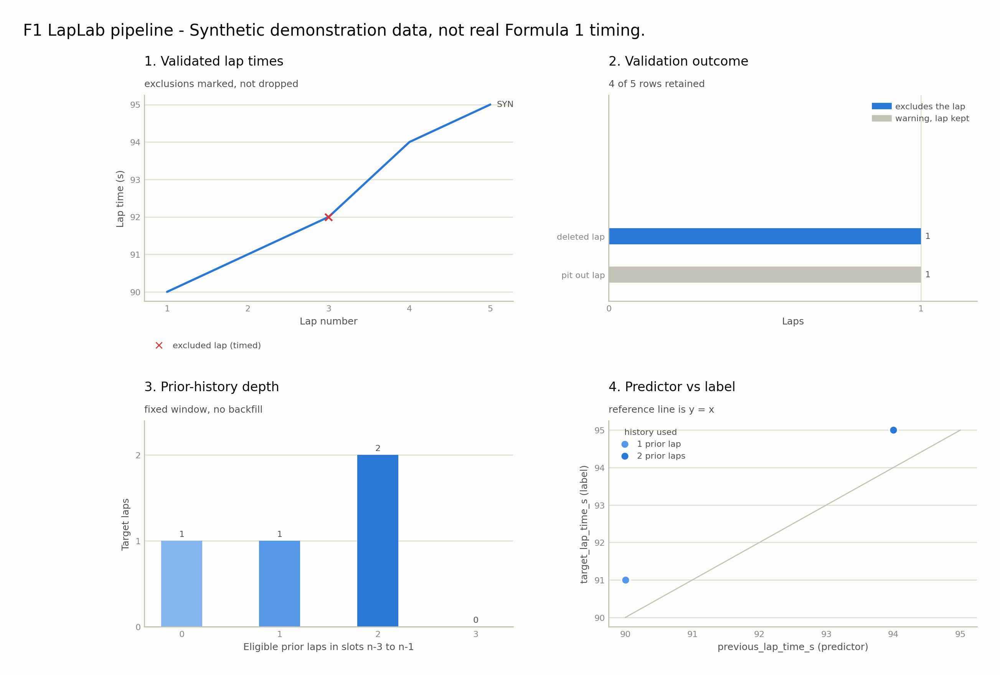

# F1 LapLab

**Formula 1 Lap Data Engineering & Feature Engineering**

F1 LapLab is a focused Python pipeline that transforms historical Formula 1
timing data into validated, structured, leakage-safe lap-level datasets suitable
for future machine-learning work. It demonstrates data ingestion, canonical
validation, domain modelling, temporal feature engineering, and automated
quality checks. **It is not a completed predictive ML system or a race strategy
simulator.**

## Problem and capabilities

Historical timing data arrives in provider-specific formats and can contain
missing, invalid, duplicated, or otherwise exceptional lap records. F1 LapLab
isolates the FastF1 boundary, converts data into an explicit canonical contract,
records validation exclusions, and builds prior-only features for predicting an
observed upcoming lap time.

- Load a selected session through the FastF1 adapter and configured cache.
- Convert timing data into the strict canonical lap schema.
- Validate canonical validity and report excluded rows and warnings.
- Represent canonical rows as typed `LapRecord` values.
- Build aligned identifiers, features, labels, and exclusion traces for each
  session, without crossing session boundaries.
- Run offline tests without accessing F1 data services.

## Architecture and data flow

The installable `f1strategy` package uses a `src/` layout and keeps provider
coupling behind the telemetry boundary:

```text
FastF1 session
  -> FastF1SessionLoader
  -> FastF1-to-canonical conversion
  -> LAPS_SCHEMA validation
  -> LoadedSession
      -> LapRecord values (optional representation)
      -> LapFeatureDataset
          -> matplotlib figures (visualization)
```

`domain` owns session identities, metadata, typed lap records, protocols,
enums, and the schema. `config` owns injected settings, project paths, and
logging. `telemetry` loads and converts FastF1 data and validates canonical
frames. `features` builds session-local, prior-only lap datasets.
`visualization` turns those validated objects into static matplotlib figures;
it loads no data and writes no files, returning figures for the caller to save.

The existing `strategy` package is a retained, illustrative deterministic
baseline using explicit assumptions. It is not part of the LapLab data pipeline
and does not implement a race strategy simulator.

See the [current architecture overview](docs/architecture/ARCHITECTURE.md).

## Feature dataset contract

The public feature API is:

```python
build_lap_features(LoadedSession) -> LapFeatureDataset
```

The target is `target_lap_time_s`: the target lap's observed time in seconds.
The prediction cutoff is immediately before that lap begins. The feature matrix
contains exactly:

| Feature | Meaning |
|---|---|
| `previous_lap_time_s` | Same driver's eligible lap at the exact `n-1` slot. |
| `prior_3lap_mean_time_s` | Mean of eligible observations in exact slots `n-3` through `n-1`. |
| `prior_3lap_valid_count` | Number of eligible observations used by that mean (0–3). |

History is session-local and keyed by driver and lap number. Missing or
ineligible slots remain missing; the mean uses available eligible observations
in the fixed window and does not backfill or extend it. Every canonically valid
timed lap is an eligible target, including pit-in/out and non-clear-track-status
laps. Duplicate eligible driver/lap identities are errors, not silently
discarded.

Identifiers and labels remain separate from predictors. Target time, target-lap
state, and future observations are not feature inputs. Tests include
perturbation and append checks to verify earlier features are unchanged by
future-lap changes.

### Scope of the leakage guarantee

The guarantee is precise about what it covers. No lap time, event marker, or
track status at or after the target lap enters a feature. It does not claim
that every input would have been knowable in a live session: prior-lap
*eligibility* is the canonical validity rule, which depends on `Deleted` and
`IsAccurate`. Both are determined after the fact — a lap time can be deleted by
the stewards some laps later, and `IsAccurate` is derived by the data provider.
A prior lap can therefore be excluded from history on information that post-dates
the stated prediction cutoff.

This is a deliberate choice for an offline, historical dataset, where the
canonical validity rule is applied consistently everywhere. A real-time
application would need to replace that eligibility test with one that is
knowable at the cutoff, and would produce different features for the same laps.

## Data availability and limitations

No historical race dataset is included or distributed in this repository. A
2024 Monaco Race FastF1 cache exists in the original development workspace but
is local, ignored by Git, and is not required by the demonstration. Real-session
loading may require external FastF1 services when data is not cached; the sample
acquisition script is optional, not part of the offline demo.

The reproducible demo uses a **small synthetic fixture**, clearly labelled in
its output. It does not represent actual Formula 1 telemetry or performance.
No trained prediction model, model evaluation, race replay, or race strategy
simulation is included. Historical provider availability, cache contents, and
lap-quality caveats remain relevant when using real sessions.

## Installation

Requires Python **3.12 or newer**. From the repository root in Windows
PowerShell:

```powershell
py -3.12 -m venv .venv
.\.venv\Scripts\Activate.ps1
python -m pip install -e ".[dev]"
```

This installs the project and its declared development tools. If activation is
restricted, invoke `.\.venv\Scripts\python.exe` directly instead.

## Figures

Rendered from the synthetic fixture below, so they show the pipeline's real
output rather than a mock-up. Panels: validated lap times with exclusions
marked, the validation outcome split into exclusions and warnings, prior-history
depth, and the predictor against its label.

<picture>
  <source media="(prefers-color-scheme: dark)" srcset="docs/images/pipeline-overview-dark.png">
  
</picture>

To regenerate every figure in both themes:

```powershell
python examples
ender_figures.py
```

The builders are pure functions -- validated domain objects in, a matplotlib
`Figure` out -- so they are unit tested by inspecting the figure rather than by
comparing pixels, and they need no display backend.

## Reproducible offline demonstration

From the repository root after installation:

```powershell
python examples\synthetic_pipeline.py
```

The script constructs an in-memory synthetic session, converts and validates
it, creates `LapRecord` values, and prints the leakage-safe feature/target rows.
It makes no network request and does not access or modify FastF1 caches.

To load the optional 2024 Monaco sample through FastF1 instead:

```powershell
python scripts\acquire_sample.py
```

That command may make network requests and write to FastF1's configured cache.
The default cache is under `data\cache`; `F1STRATEGY_CACHE_DIR` can select
another location. The offline demonstration and tests do not require this step.

## Tests and code quality

Run from the repository root:

```powershell
python -m pytest -m "not network"
python -m ruff check src\ tests\ examples\ scripts\
python -m mypy src\ tests\ examples\ scripts\
git diff --check
```

The `network`-marked FastF1 integration test is excluded from the offline test
command. Run it only when the required cached data or external access is
available and explicitly intended.

## Future possibilities

Possible follow-up work includes a reproducible manifest for acquired sessions,
more cross-session quality checks, and an independently approved held-out
weekend baseline evaluation. These are not implemented. Any future model must
preserve the current feature/label separation and use evaluation splits that
keep race weekends independent.
