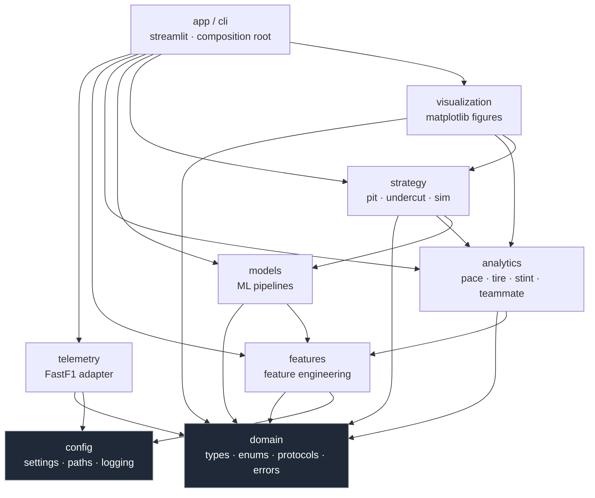

# Historical Dependency Graph Proposal

> This document describes the original motorsport-platform proposal, not the
> current F1 LapLab architecture. See [the implemented architecture](ARCHITECTURE.md).

The dependency rule: **an arrow `A → B` means "A may import B".** There are no
cycles. Reverse imports are forbidden by convention. The only part of this rule
that is mechanically enforced is the FastF1 boundary, checked by
`tests/architecture/test_import_boundaries.py`. This repository has no CI
pipeline; the quality gates are run locally (see the root README).

## Module graph (Mermaid)



## Critical invariants

1. **`domain` and `config` are leaves.** They import only the standard library
   (plus, for `config`, optionally `pydantic`/dataclasses). Nothing in the project
   sits below them, so they can never participate in a cycle.

2. **`fastf1` appears only inside `telemetry/`.** This is the anti-corruption
   boundary. Enforced by `tests/architecture/test_import_boundaries.py`; the
   sketch below is illustrative, not the implemented code:

   ```python
   # tests/architecture/test_import_boundaries.py
   def test_fastf1_only_imported_in_telemetry():
       offenders = grep_imports("fastf1", under="src/f1strategy")
       allowed = {"src/f1strategy/telemetry"}
       assert all(path.startswith(tuple(allowed)) for path in offenders)
   ```

3. **No layer imports `app`.** The composition root is the top of the graph;
   business layers never reach "up" into the UI.

4. **`visualization` never loads data.** It receives typed analytics/strategy
   objects and returns figures. If a chart needs data, the caller (app) loads it.

5. **`strategy` is the only place analytics and models meet.** Strategy is where
   "what happened" (analytics) and "what will happen" (models) combine into
   "what to do" (recommendations).

## Why this shape

- A change to FastF1's API touches **one** package.
- A test of `analytics` needs **no** network — it builds a `LoadedSession` from a
  fixture frame and calls the function. (See INTERFACES §2 protocols.)
- The graph is acyclic, so the package can always be imported top-down and tools
  like `mypy` and `import-linter` can verify the contract mechanically.

## Build / runtime dependency direction vs. data-flow direction

Note these point *opposite* ways, which is correct and intentional:

- **Imports** point inward/downward (`app → strategy → models → features → domain`).
- **Data** flows outward/upward (`telemetry produces → features → analytics →
  strategy → app renders`).

Inner layers define contracts; outer layers fulfill orchestration. Data rides the
contracts in the other direction. This is the standard clean-architecture inversion.
